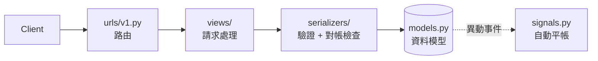

# Records 記帳系統後端 API

> 專為「代購墊款、預購周邊、生活拆帳」設計的記帳 API。
> 以 **主單－明細** 架構拆分一筆支付，並用 **Django Signals** 自動維持帳戶餘額一致。
>
> 🚧 開發中的個人作品：核心資料模型與關鍵機制已實作，部署與測試仍在規劃中。

## 目錄

- [專案簡介](#專案簡介)
- [開發狀態](#開發狀態)
- [核心設計與實作](#核心設計與實作)
- [開發挑戰與對策](#開發挑戰與對策)
- [系統架構與技術棧](#系統架構與技術棧)
- [資料庫設計](#資料庫設計)
- [快速開始](#快速開始)
- [資料夾結構說明](#資料夾結構說明)
- [已知限制與後續規劃](#已知限制與後續規劃)

---

## 專案簡介

### 為什麼做這個系統？

我的消費行為很多元：幫朋友代購墊款、預購興趣周邊、和朋友拆帳……
一般記帳軟體通常只能把一筆支出歸到單一類別，結果：

- 無法區分「**個人開銷**」與「**代墊資產**」，個人財務分析失真
- 超商合併結帳這類「一張收據、多種歸屬」的情境無法記錄
- 預購商品等待數週甚至數月，預付款容易被遺忘，難以追蹤長週期資金流向

### 專案目標

透過**資料庫正規化**與**自動化邏輯**，建立一套具備「主單－明細」架構的記帳 API，
達成精準的資產管理、自動化平帳，以及多維度的消費追蹤。

完整系統分析請見 [`doc/sys.docx`](doc/sys.docx)。

---

## 開發狀態

> 🚧 **開發中（WIP）**

| 項目 | 狀態 |
|---|---|
| 資料模型與 Migration（0001 ~ 0006） | ✅ 已建立 |
| 主單－明細拆帳架構 | ✅ 已實作 |
| Signals 自動平帳（新增／修改／刪除） | ✅ 已實作 |
| Serializer 對帳檢查（主單總額 vs 明細加總） | ✅ 已實作 |
| 依領域拆分的 views / serializers / API 版本化路由 | ✅ 已建立 |
| 自動化測試 | ⏳ 待補 |
| 套件鎖版（`requirements.txt`） | ⏳ 待補 |
| 部署（Nginx + Gunicorn）與 PostgreSQL 遷移 | 📝 規劃中 |
| 容器化（Docker） | 📝 規劃中 |

---

## 核心設計與實作

### 1. 多維度拆帳（主單－明細）

一筆交易（`Transaction`）可掛載多筆明細（`TransactionItem`），
每筆明細可**獨立設定歸屬對象與分類**。

> 例：在超商合併結帳 $30，其中 $10 是自己的零食、$20 是幫朋友代墊，
> 只需一張主單、兩筆明細，個人開銷與代墊資產就能分開統計。

### 2. 事件驅動的自動平帳（Django Signals）

帳務連動邏輯（收入加款、支出扣款、轉帳雙向異動）**集中在 Signals**，
而不是分散在各個功能頁面。

- **單一事實來源**：不論資料來自管理後台、API 或自動化腳本，只要資料庫異動，
  系統都會自動感應並更新餘額。
- **完整涵蓋新增、修改、刪除**：修正過往紀錄時，系統自動計算差值並即時修正帳戶餘額。
- **效益**：從根本避免「紀錄與餘額對不起來」的系統性風險。

### 3. Serializer 對帳檢查（API 守門員）

拆帳最常見的人為錯誤，是主單總額與明細加總不符。
檢查規則定義在 Serializer 層：

| 輸入 | 結果 |
|---|---|
| 主單總額 $25，明細 $10 + $20 = $30 | ❌ 於 API 入口立即攔截，回傳錯誤訊息 |
| 主單總額 $30，明細 $10 + $20 = $30 | ✅ 通過 |

**為什麼放在 Serializer？** 規則只需定義一次，新增、編輯、批次匯入
乃至未來的手機 App、Telegram Bot 等任何入口都自動套用，不必重複撰寫。

### 4. 長週期交易狀態追蹤

針對「非現貨」或「預購商品」，以明細的 `status` 欄位管理實體資產流向
（例如：非現貨 → 已收到），避免預付款在長時間等待中被遺忘。

### 5. 其他設計

- **API 版本化**：路由集中在 `records/urls/v1.py`，升版時新增 `v2.py` 即可，不影響既有用戶端。
- **依領域拆分**：`views/`、`serializers/` 依 `account`、`category`、`contact`、`transaction` 分檔，職責單一。
- **軟刪除**：帳戶與分類以 `is_deleted` 標記，避免歷史交易失去參照。

---

## 開發挑戰與對策

| | 內容 |
|---|---|
| **挑戰** | 實作「修改舊紀錄」的連動邏輯時，發現 Python 記憶體內物件的餘額，可能與資料庫即時狀態不一致（**Stale Data**），多次修改後金額產生偏差。 |
| **對策** | 在任何金額演算前，使用 `refresh_from_db()` 強制重新讀取最新狀態，確保高頻修改或複雜轉帳情境下，每次演算都基於正確的資料。 |

---

## 系統架構與技術棧

### 技術棧

| 項目 | 開發階段 | 正式環境（規劃） |
|---|---|---|
| 語言 | Python 3.12 | 同左 |
| 後端框架 | Django 6.0.4 + Django REST Framework | 同左 |
| 資料庫 | SQLite | PostgreSQL |
| Web 伺服器 | `runserver` | Nginx + Gunicorn |
| 部署環境 | Linux（WSL2） | 雲端虛擬機（如 AWS EC2、GCP） |

> **為何用 WSL2 開發？** 模擬真實雲端伺服器的 Linux 環境，
> 在開發階段就確保跨平台穩定，縮短日後部署的調試週期。
>
> **為何正式環境換 PostgreSQL？** 因應高併發處理與嚴謹的事務（Transaction）需求。

### 請求流程



---

## 資料庫設計

採高度正規化設計，確保擴充性與靈活性。

| 模型 | 說明 | 關鍵欄位 |
|---|---|---|
| `Account` | 資產帳戶管理 | 餘額（Balance）、幣別（Currency） |
| `Contact` | 對象關係管理 | 歸屬人（自己、代購客、團主） |
| `Category` | 消費分類管理 | 分類名稱（食、周邊、約稿） |
| `Transaction` | 交易主單（父層） | 總額、交易類型（收入／支出／轉帳） |
| `TransactionItem` | 交易明細（子層） | 金額、分類（FK）、狀態（非現貨／已收到） |

---

## 快速開始

### 前置需求

- Python 3.12
- Git
- Linux 環境（本專案於 WSL2 / Ubuntu 開發）

### 本地端執行

```bash
# 1. 取得專案
git clone <你的儲存庫網址>
cd <專案資料夾>

# 2. 建立並啟用虛擬環境
python3 -m venv venv
source venv/bin/activate

# 3. 安裝套件（requirements.txt 尚未整理，先手動安裝）
pip install django djangorestframework
pip install -r requirements.txt
cp .env.example .env      # 然後編輯 .env 填入自己的金鑰

# 4. 建立資料表
python manage.py migrate

# 5. 啟動開發伺服器（預設 Port 8000）
python manage.py runserver
```


啟動後可存取 `http://127.0.0.1:8000/`。
若需後台：執行 `python manage.py createsuperuser` 後前往 `/admin/`。

### Docker

> 📝 規劃中，尚未提供 `Dockerfile` 與 `docker-compose.yml`。

---

## 資料夾結構說明

```text
.
├── manage.py              # Django 管理指令入口
├── requirements.txt       # 套件清單（待整理）
├── db.sqlite3             # SQLite 開發資料庫
├── doc/
│   └── sys.docx           # 系統分析文件
├── config/                # 專案層級設定
│   ├── settings.py        # 全域設定
│   ├── urls.py            # 根路由
│   ├── wsgi.py            # WSGI 入口
│   └── asgi.py            # ASGI 入口
└── records/               # 核心應用
    ├── models.py          # 資料模型
    ├── signals.py         # 自動平帳（Signals）
    ├── admin.py           # 後台註冊
    ├── tests.py           # 測試（待補）
    ├── migrations/        # 資料庫遷移
    ├── serializers/       # 序列化器與對帳檢查（依領域拆分）
    ├── views/             # 視圖（依領域拆分）
    └── urls/              # 路由（v1.py = API v1）
```

---

## 已知限制與後續規劃

**目前限制**

- 使用開發設定（`DEBUG = True`、`ALLOWED_HOSTS = []`），尚不適用於正式環境。
- 資料庫為 SQLite，僅供開發。
- 尚未建立自動化測試。

**後續規劃**

- [ ] 為 Signals 平帳與 Serializer 對帳檢查補單元測試
- [ ] 整理 `requirements.txt`（`pip freeze` 鎖版本）
- [ ] 將 `SECRET_KEY` 等敏感設定改由環境變數讀取
- [ ] 遷移至 PostgreSQL，並以 Nginx + Gunicorn 部署至雲端
- [ ] 容器化（Dockerfile / docker-compose）
- [ ] 串接 Telegram Bot 或手機 App 作為輸入端